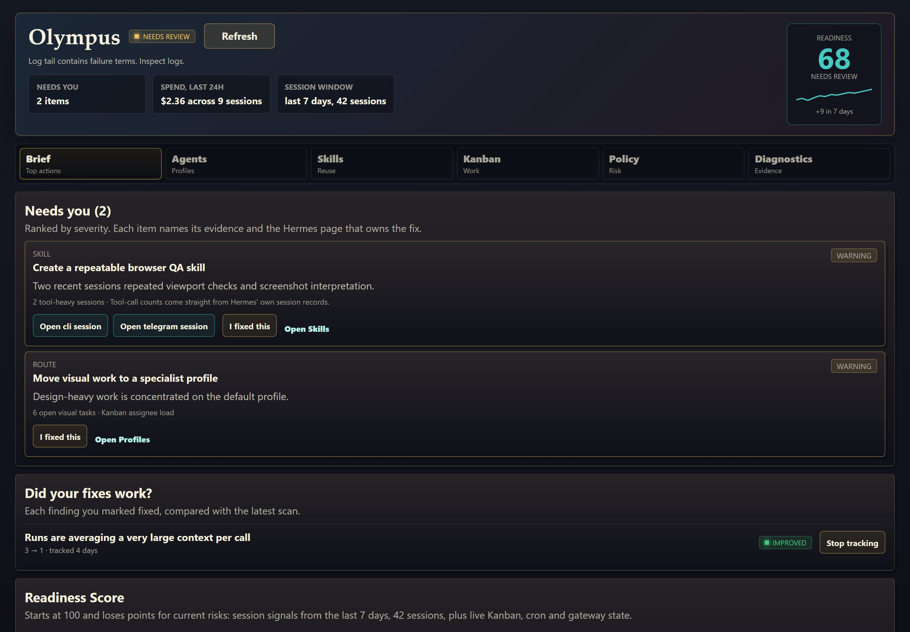

# Olympus

Olympus is a read-only operator console for [Hermes Agent](https://github.com/NousResearch/hermes-agent): what broke, what it cost, and what to fix next across every profile.

It reads local Hermes runtime state and shows what to tune next across profiles,
routes, skills, sessions, cron, gateways, Kanban work, and runtime health. It
does not run agents and does not replace Hermes admin pages. It explains how the
agent system is performing and links to the Hermes page that owns each fix.

See [`OLYMPUS_GOAL.md`](OLYMPUS_GOAL.md) for the product boundary (what Olympus
owns vs. what Hermes owns).



## What It Does

- Ranks agent optimization items with the evidence behind each one.
- Compares profile readiness, route metadata, skill coverage, gateway state, and workload.
- Summarizes Kanban pressure: blocked work, active workers, retries, and assignee load.
- Surfaces safe config policy risks: turn limits, loop guardrails, browser privacy flags, fallbacks, toolsets, and auxiliary cost visibility.
- Computes a transparent heuristic readiness score with a full deduction breakdown.
- Opens with a Brief view for the next action, then stages deeper panels behind Agents, Skills, Kanban, Policy, and Diagnostics tabs.
- Adds Metrics Spine in Diagnostics: aggregate Hermes-grounded usage visibility, profile workload, skill lifecycle, and work reliability for tuning.
- Keeps v1 read-only: every action is a link to the Hermes page that owns it.

## What It Does Not Do

- Create or move Kanban tasks, or spawn workers.
- Edit profiles, cron, gateways, routes, memory, MCP, keys, or config.
- Rebuild Hermes Usage/Analytics for token, model, session, or spend totals.
- Show secrets, or expose local labels/paths unless explicitly enabled.

## Requirements

- Hermes Agent v0.21.6 or newer (`requires_hermes: ">=0.21.6"` in
  [`plugin.yaml`](plugin.yaml)). Verified against v0.22.5.
- Nothing else: Olympus has no Python dependencies and no frontend build step.

## Install

```bash
hermes plugins install AIEngineerX/Olympus
hermes plugins enable olympus
hermes dashboard
```

Then open the **Olympus** tab (default `http://127.0.0.1:9119/olympus`).
Hermes loads user plugin APIs only for plugins listed in `plugins.enabled`,
which is what `hermes plugins enable` writes. If the tab appears without data,
restart `hermes dashboard` once.

To work on Olympus itself, see [`CONTRIBUTING.md`](CONTRIBUTING.md).

## Alerts (opt-in)

Olympus can tell you when something breaks: a cron job fails or stops running
on time, a Kanban worker stalls or fails, a session starts looping, or spend
jumps to twice its daily average.

```bash
hermes olympus install-alerts --deliver telegram   # any `hermes cron --deliver` target
```

This copies one script, `olympus_alerts.py`, into `$HERMES_HOME/scripts/` and
prints the `hermes cron create --no-agent ...` command to run. Hermes cron then
runs the script on your schedule and delivers what it prints through your own
delivery target. No model is called, and a run with nothing new is silent. An
alert repeats at most every six hours while it is still active. Check on demand
with `hermes olympus alerts --preview`; stop with `hermes cron remove <job id>`.

With `plugins.isolation: host`, Hermes does not wire plugin CLI commands. Copy
`alerts/olympus_alerts.py` from the installed plugin into `$HERMES_HOME/scripts/`
yourself and run the same `hermes cron create` command.

## What Olympus Reads and Writes

Olympus never writes Hermes state. Every Hermes store is opened read-only, it
makes no network calls, runs no background processes, and stores no
credentials. It writes only:

- `$HERMES_HOME/plugin-data/olympus/history.db`: daily snapshots and the
  findings you marked fixed;
- `$HERMES_HOME/plugin-data/olympus/alerts.json`: which alerts were sent, when
  alerts are enabled;
- `$HERMES_HOME/scripts/olympus_alerts.py`, only when you run
  `hermes olympus install-alerts`.

Per request it reads, for each profile:

- `state.db` session counters (tokens, cost, tool calls, timestamps, handoff errors)
  and per-task background usage (`session_model_usage`)
- `cron/jobs.json` job status and `cron/usage_audit.jsonl` per-run token counts
- `config.yaml` structure and flags (never values such as keys or base URLs)
- `.env` variable **names** only, to detect configured gateways
- `gateway.pid` / `gateway_state.json` for gateway liveness
- the last 8 KB of `logs/agent.log`, `logs/gateway.log` and `logs/errors.log`
- `skills/` metadata and `skills/.hub/lock.json`

and the shared Kanban databases under the Hermes root.

## Dashboard Modes

Olympus opens in Brief mode, which answers "what needs me?" first:

- the readiness score, how many findings need you, spend in the last 24 hours,
  and the session window every signal covers (the last 7 days);
- **Needs you**: ranked findings with their evidence, the Hermes page that owns
  the fix, and buttons that open the sessions behind a finding in Hermes chat;
- the readiness score's top deductions;
- Agent Monitor tiles for the same window.

Deeper inspection is split into purpose-built tabs:

- Agents: Performance Tracking, Profile Fitness, and Live Work (who is running
  what, and recent Kanban activity).
- Skills: Skill Coverage and Skill Hygiene.
- Kanban: Trace Spine and Kanban Intelligence.
- Policy: Tool Policy & Aux Cost.
- Diagnostics: Operational Evals, with Metrics Spine, payload budgets and
  Evidence Sources under "Debug details".

## Hermes Desktop

Hermes Desktop owns chat, agents, profiles, skills, sessions, cron, settings,
and Command Center Usage. Olympus is the read-only operations monitor beside
those controls. It should show risk and evidence, then link to the Hermes page
that owns the fix.

Today Olympus is verified through the Hermes web dashboard at `/olympus`.
Desktop visibility requires Hermes Desktop plugin-tab parity for dashboard
plugins. See
[`dashboard/docs/HERMES_DESKTOP_INTEGRATION.md`](dashboard/docs/HERMES_DESKTOP_INTEGRATION.md).

Run `npm run test:desktop` to verify the local Desktop app, Command Center
Usage ownership, web dashboard plugin support, and the current plugin-tab parity
status before preparing an upstream Desktop PR.

## API

Hermes mounts the Olympus API at `/api/plugins/olympus/` once the plugin is enabled:

| Route | Purpose |
| --- | --- |
| `GET /health` | Liveness and a coarse runtime status summary |
| `GET /overview` | Full dashboard read model: health, tuning, profiles, gateways, cron, sessions, Kanban, performance, Trace Spine, Operational Evals, Metrics Spine, skill hygiene, config policy, and evidence sources |
| `GET /tuning` | Tuning-focused read model with score breakdown, Kanban intelligence, Trace Spine, Operational Evals, Metrics Spine, skill hygiene, config policy, performance, and evidence sources |
| `POST /fixes?key=` / `DELETE /fixes?key=` | Start or stop tracking a current finding you fixed (Olympus' own storage). |
| `GET /open/session?ref=` | Resolves a hashed session ref to its Hermes chat URL (`/chat?resume=…&profile=…`), or `{"href": null}` when the session is gone. Raw session IDs leave the backend only through this click-time lookup. |

Routes sit behind the Hermes dashboard session-token middleware. The frontend
calls them through the plugin SDK's `fetchJSON`, which injects the token. If
the plugin is installed but not enabled, the tab renders a reduced view from
Hermes' own dashboard APIs; `npm run test:compat` reports which mode is active.

## Privacy

Olympus hides session titles, Kanban task titles, cron names, exact route labels,
and local paths by default. To show richer local labels on a private machine, set this in
`config.yaml` (it is re-read on every request, so no restart is needed):

```yaml
# $HERMES_HOME/config.yaml
dashboard:
  olympus:
    expose_local_labels: true
```

See [`SECURITY.md`](SECURITY.md) for the full security and privacy posture.

## Project Layout

```text
.
├── dashboard/
│   ├── manifest.json            # plugin metadata, tab path, assets, api module
│   ├── plugin_api.py            # FastAPI router (read-only backend)
│   ├── dist/index.js            # hand-authored SDK React frontend
│   ├── dist/style.css           # olympus-* styles
│   ├── docs/BUILD_PLAN.md       # implementation plan
│   ├── docs/HERMES_DESKTOP_INTEGRATION.md
│   ├── docs/PRODUCTION_READINESS.md
│   ├── docs/VIEWPORT_STRATEGY.md
│   ├── docs/FRONTEND_SKILL_RESEARCH.md
│   └── README.md                # package notes
├── docs/assets/olympus-dashboard.jpg
├── scripts/install-dashboard-link.sh
├── scripts/olympus-live-smoke.mjs
├── scripts/olympus-performance-smoke.mjs
├── tests/visual/                 # Playwright fixture checks
├── tests/fixtures/                # Olympus browser fixtures
├── package.json                   # verification scripts
├── after-install.md              # post-install checks
├── OLYMPUS_GOAL.md              # product boundary
├── TODO.md                      # active backlog
├── SECURITY.md                  # security and privacy notes
├── CONTRIBUTING.md              # development and contribution guide
├── LICENSE                      # MIT
└── README.md
```

Note: `dashboard/dist/*` is hand-authored SDK React/CSS. There is no bundler or
build step. See [`CONTRIBUTING.md`](CONTRIBUTING.md) for the development workflow.

## Verify

```bash
npm run verify
npm run test:compat
npm run test:visual
npm run test:live
npm run test:performance
npm run test:security
npm run test:desktop
npm audit --audit-level=moderate
```

`npm run test:visual` uses a fixture-backed Playwright harness. It loads the
hand-authored dashboard assets directly, checks desktop/mobile readability across
multiple fixture states, validates link destinations, verifies empty evidence
sections stay hidden, verifies staged dashboard modes, and catches private-label
leaks in the no-labels scenario.

`npm run test:compat` diagnoses whether the current Hermes install mounted
Olympus backend routes or is running in static-user-plugin mode. If it reports
`backendMounted: false` with the non-bundled backend refusal reason, the live
backend gates are blocked by Hermes' security boundary rather than by a frontend
or syntax failure.

`npm run test:live` checks the real Hermes dashboard route at
`http://127.0.0.1:9119/olympus`. It starts Hermes when needed, verifies
desktop/mobile rendering, clicks each dashboard mode, and fails on console
errors, overflow, tiny labels, bad links, SVG text, or missing staged panels.

`npm run test:performance` checks the real `/overview` and `/tuning` plugin API
routes through the Hermes session-token flow. It fails on non-2xx responses,
slow local response time, backend diagnostic budget warnings, or payloads above
the documented budget.

The live smoke runner reuses an existing Hermes dashboard only when the served
HTML includes the Hermes session token. If it needs to start Hermes and your
`$HERMES_HOME/plugins/olympus/dashboard` target already points somewhere else,
set `OLYMPUS_SMOKE_RELINK=1` before running the smoke command.

## Quality Gates

- API responses redact session IDs, private labels, paths, and secrets unless
  `dashboard.olympus.expose_local_labels` is explicitly enabled in `config.yaml`.
- Brief mode hides deep panels by default; visual and live smoke tests click the
  tabs that own Agents, Skills, Kanban, Policy, and Diagnostics.
- Live Work uses HTML text and accessible profile buttons rather than SVG text or an
  image-role wrapper.
- Metric chips appear only for warning, critical, stale or blocked values.
- The frontend polls `/overview` one request at a time; the next poll starts
  only after the previous response settles.
- Attention items are sorted by severity before truncation.
- Gateway configuration detection parses `.env` variable names only; values are
  not scanned or returned.
- Config policy reads only safe structure, counts, and flags; it does not return
  prompt text, base URLs, API keys, env values, or local paths.
- Dependencies are exact-pinned in `package.json`, locked in
  `package-lock.json`, and checked with `npm audit --audit-level=moderate`.

## Contributing

Contributions are welcome. Please read [`CONTRIBUTING.md`](CONTRIBUTING.md)
first. It covers the local dev loop, the read-only and privacy rules, the
verification commands, and commit/PR conventions.

## Security

Found a security or privacy issue? See [`SECURITY.md`](SECURITY.md) for the
posture and how to report.

## References

- [Hermes Agent](https://github.com/NousResearch/hermes-agent)
- [Hermes Agent documentation](https://hermes-agent.nousresearch.com/docs)
- [`dashboard/docs/PRODUCTION_READINESS.md`](dashboard/docs/PRODUCTION_READINESS.md)
- [`dashboard/docs/VIEWPORT_STRATEGY.md`](dashboard/docs/VIEWPORT_STRATEGY.md)

## License

[MIT](LICENSE), AIEngineerX.
