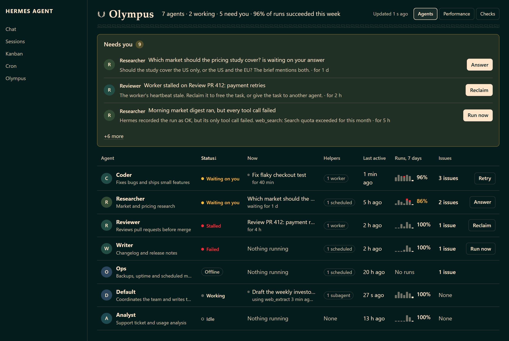
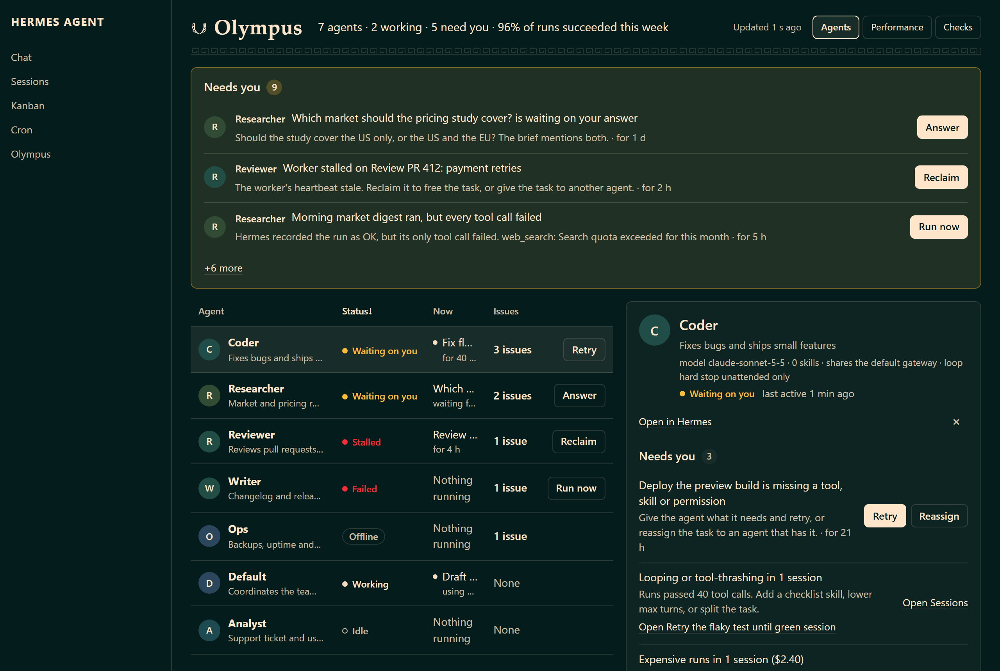
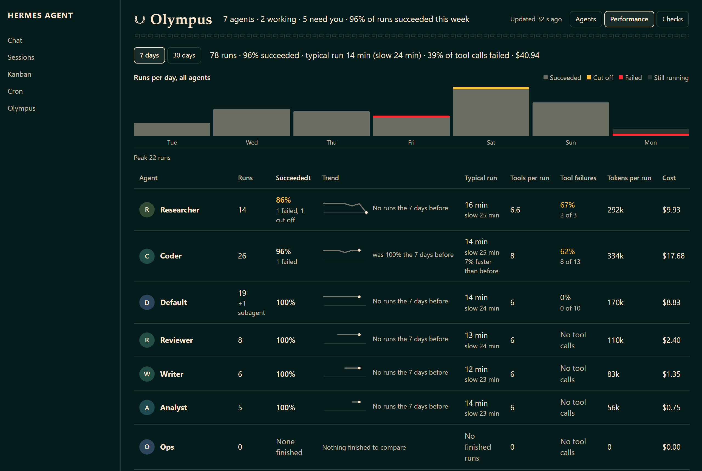

# Olympus

Olympus is where you manage your [Hermes Agent](https://github.com/NousResearch/hermes-agent)
agents: every agent on one list, what each is doing, what is waiting on you, and
how reliably its runs succeed. It is a Hermes dashboard plugin.

It exists for operators running several agents with cron jobs and Kanban
workers, who find out late that something failed, stalled or got stuck. The
problems it targets, and the Hermes issues that show people have them, are in
[`PRODUCT.md`](PRODUCT.md).

## What you see



- **Agents.** One row per agent (Hermes profile): status in a word, the task and
  tool it is on now, its helpers, last activity, and a week of runs with the
  failed ones marked. Above it, **Needs you**: every question waiting on an
  answer (with the question the agent asked), failed or overdue cron job
  (including a run Hermes recorded as OK in which every tool call failed),
  stalled or failing worker, blocked or unassigned task, offline gateway, and
  looping or expensive run, once each, with its action. Pick an agent to open
  its inspector: what it did recently,
  its scheduled jobs and Kanban work, how it works, and whether your fixes
  worked.


- **Performance.** For 7 or 30 days: runs, how many succeeded, typical and slow
  run time, tool calls that failed, and cost, per agent and across all of them,
  each compared with the same number of days before ("96% of 25, was 100% the
  7 days before", "7% faster than before") beside a success-rate-per-day line.
  Outcomes follow Hermes' own session status, except that a scheduled run in
  which every tool call failed counts as failed. Any run opens step by step.
- **Checks.** Findings across your agents, Kanban backlog grouped by who has to
  act, skill hygiene, configuration risks, and where spend goes.



Everything works at phone width too; the roster becomes cards and each panel
opens full screen with a Back button.

## Controls

From the queue and the inspector you can pause, resume or run a cron job (or
pause all of an agent's jobs), and answer, retry, reclaim, reassign or assign a
Kanban task. Every control says exactly
what it will do and waits for you to confirm. Hermes' own API does the work
(`/api/cron/jobs/...` and the Kanban plugin's task routes), and Olympus records
each action in its log.

To turn every control off:

```yaml
# $HERMES_HOME/config.yaml
dashboard:
  olympus:
    controls: false
```

Anything else (creating or deleting agents, jobs or tasks; editing prompts,
models, skills, keys or config) stays on the Hermes page that owns it, and
Olympus links there.

## Install

Requires Hermes Agent v0.21.6 or newer; verified against v0.22.5. No Python
dependencies and no build step.

```bash
hermes plugins install AIEngineerX/Olympus
hermes plugins enable olympus
hermes dashboard
```

Open the **Olympus** tab (default `http://127.0.0.1:9119/olympus`). Hermes loads
a user plugin's API only once it is in `plugins.enabled`; until then the tab
lists your agents from Hermes' own API and says how to enable the rest. If the
tab shows no data after enabling, restart `hermes dashboard` once.

## What Olympus reads and writes

Olympus never writes Hermes files or databases. It opens every Hermes store
read-only, makes no network calls of its own, runs no background processes and
stores no credentials. Per request it reads, for each profile:

- `state.db`: sessions and messages (timestamps, tokens, cost, tool calls,
  outcomes)
- `cron/jobs.json` and `cron/usage_audit.jsonl`
- `config.yaml` structure and flags (never values such as keys or base URLs)
- which messaging platforms each profile has configured, as Hermes itself
  reports it (Olympus never opens a profile's `.env`)
- gateway process state, and the last 8 KB of the agent, gateway and error logs
- `skills/` metadata and the skill hub lock

and the Kanban databases under the Hermes root. It writes only to
`$HERMES_HOME/plugin-data/olympus/` (daily snapshots, findings you marked fixed,
the action log, alert state), plus `$HERMES_HOME/scripts/olympus_alerts.py` if
you install alerts.

## Alerts (opt-in)

Olympus can tell you when a task is waiting on your answer, a cron job fails
or stops running on time, a Kanban worker stalls or fails, an agent's gateway
is not running while jobs or tasks wait on it, a session starts looping, or
spend jumps to twice its daily average:

```bash
hermes olympus install-alerts --deliver telegram   # any `hermes cron --deliver` target
```

This copies `olympus_alerts.py` into `$HERMES_HOME/scripts/` and prints the
`hermes cron create --no-agent ...` command to run. Hermes cron runs it on your
schedule and delivers what it prints; no model is called, and a run with
nothing new is silent. An alert repeats at most every six hours while it is
still active. Preview with `hermes olympus alerts --preview`; stop with
`hermes cron remove <job id>`. With `plugins.isolation: host`, copy
`alerts/olympus_alerts.py` into `$HERMES_HOME/scripts/` yourself.

## Hermes Desktop

Desktop does not render web-dashboard tabs, so Olympus ships a Desktop page
too (`desktop/plugin.js`). Installing the plugin copies it into
`$HERMES_HOME/desktop-plugins/olympus/`; turn it on under **Capabilities →
Plugins**. Today it shows the findings that need you (with sessions that open
in Desktop and "I fixed this"), fix tracking, cron spend and backlog triage.
The roster, queue and inspector are coming to Desktop next.

## Privacy

Session titles, task titles, cron names, model labels, message content and
local paths are hidden by default. To show them on a private machine:

```yaml
# $HERMES_HOME/config.yaml
dashboard:
  olympus:
    expose_local_labels: true
```

Both settings are re-read on every request. See [`SECURITY.md`](SECURITY.md).
Keep the Hermes dashboard on localhost.

## API

Mounted at `/api/plugins/olympus/` behind the Hermes dashboard session token:

| Route | Purpose |
| --- | --- |
| `GET /overview` | Roster, Needs you, findings, backlog, skills, policy, spend |
| `GET /agent?ref=` | One agent's inspector |
| `GET /performance?days=7\|30` | Run success, run time, tool failures and cost per agent |
| `GET /run?ref=` | One run, step by step |
| `GET /resolve?kind=&ref=` | The id a control needs, looked up at click time; refused when controls are off |
| `POST /actions` | Record a control in the action log |
| `POST /fixes?key=` / `DELETE /fixes?key=` | Start or stop tracking a finding you fixed |
| `GET /open/session?ref=` | A session's Hermes chat link, or `null` if it is gone |
| `GET /health` | Liveness and a coarse runtime summary |

## Verify

```bash
npm run verify            # backend compiles, Python tests, frontend parses
npm run test:visual       # Playwright on fixture data, desktop and 390 px
npm run test:live         # the real Hermes dashboard, desktop and 390 px
npm run test:security     # live payload: no secrets, paths or raw ids
npm run test:performance  # live /overview and /performance response budgets
npm run test:compat       # whether Hermes mounted the Olympus API
npm run test:desktop      # Desktop page preflight
```

The live, security and performance smokes use an existing Hermes dashboard at
`OLYMPUS_SMOKE_URL` (default `http://127.0.0.1:9119/olympus`), or start one.

## Layout

```text
dashboard/plugin_api.py   FastAPI backend: reads Hermes, builds every view
dashboard/dist/           hand-authored SDK React (index.js) and styles; no build step
desktop/plugin.js         Hermes Desktop page
alerts/olympus_alerts.py  script for the opt-in alert cron job
plugin.yaml, __init__.py  catalog manifest and the `hermes olympus` command
scripts/                  smokes, dev link, fixture builder
tests/                    Python tests and Playwright fixture checks
PRODUCT.md, DESIGN.md     what Olympus is for, and how it looks
```

## Known issues

Seen on the test install; not yet fixed.

- A Kanban worker that has finished can read as **Working** for up to ten
  minutes, because Hermes leaves the worker's session open after the task run
  ends. The next release will end the agent's status with the run.
- While a worker runs, "Now" shows its task but not the tool it is using.
- At 390 px the confirm popup for a control can overflow its row by a pixel.

If you hit anything else, [open an issue](https://github.com/AIEngineerX/Olympus/issues)
and say what Olympus showed and what Hermes' own page showed.

## Contributing, security, license

See [`CONTRIBUTING.md`](CONTRIBUTING.md) and [`SECURITY.md`](SECURITY.md).
[MIT](LICENSE), AIEngineerX.
